<p align="center">
  
</p>

<p align="center">
  <b>Stop AI coding agents from shipping yesterday's vulnerabilities, and prove the fix actually works.</b>
</p>

<p align="center">
  
  
  
  
  
  
</p>

<p align="center">
  <a href="#why-paladin">Why</a> |
  <a href="#how-it-works">How it works</a> |
  <a href="#quick-start">Quick start</a> |
  <a href="#proof-not-similarity">Proof</a> |
  <a href="#status">Status</a> |
  <a href="#roadmap">Roadmap</a> |
  <a href="#documentation">Docs</a>
</p>

---

## Why Paladin

AI coding agents learn from decades of public code, including code that was later
patched for a CVE. When an agent writes `subprocess.check_output(["hg", "checkout", branch])`
it can quietly reintroduce a weakness that was already found, disclosed and fixed.
The knowledge to prevent it exists - in CVE records, upstream patches and regression
tests - but it is not in front of the agent when the code is written, and today's
tools mostly answer with **similarity**: "this looks like something risky."

Similarity is not proof. A warning that cannot show the vulnerable behavior, and cannot
show that the fix blocks it without breaking normal use, is easy to ignore and easy to
get wrong.

**Paladin's goal is to make known-vulnerability recurrence in AI-written code rarer,
with evidence a human can audit.** It does three things:

| | Value | What it means |
|---|---|---|
| 1 | **Grounded prevention** | Agents get CVE causes, upstream patch context and prevention conditions through MCP *before and while* they write code - with provenance, not vibes. |
| 2 | **Proof over similarity** | A fix is only recorded when the original behavior is *observed* to be exploitable, the repair is *observed* to block it, and normal behavior is *observed* to still work - inside an isolated sandbox. |
| 3 | **Local-first knowledge** | Code, embeddings and evidence stay on your machine. The long-term idea is a consented loop where many local databases reveal shared failure conditions and receive reviewed prevention rules back. |

Paladin is deliberately honest about what it does not know: unsupported, partial and
unavailable states are reported as such and never turned into a "safe" verdict.

## How it works

<p align="center">
  
</p>

1. **Scan** - Paladin receives only a project root. A static AST matcher finds source
   structures tied to a specific CVE. A candidate is a lead, not a verdict.
2. **Reproduce** - The original code runs inside a locked-down container against real
   local Mercurial/Git fixtures. A separate root `strace` observer records which
   programs were executed, with which arguments, in which directory.
3. **Repair** - A deterministic, byte-range repair is applied to a staged copy.
   The original project is never modified.
4. **Verify** - The repaired code runs the same cases. Risky inputs must now be passed
   as protected arguments, and ordinary checkouts must still succeed. The observer
   re-runs the exact observed command in a clean, root-owned clone, so files or hooks
   the target controls cannot fake a successful checkout.
5. **Promote** - Only when every check passes is the case stored, signed with a host
   HMAC key that never enters the container. Every reuse re-validates the signature,
   the trace, the runtime image identity and the repair.

## Proof, not similarity

The sandbox boundary is part of the product, not an afterthought:

- `--network=none`, read-only root filesystem, no host mounts, all capabilities dropped,
  target runs as uid 65534 with no-new-privileges, CPU/memory/PID/time limits.
- A seccomp filter denies untraceable process creation (`clone(CLONE_UNTRACED)`, `clone3`),
  so every child process stays visible to the observer. This was found to be a real
  evasion path and is covered by a live control.
- One strict trace grammar is shared by the observer and the host; truncated,
  ambiguous or unknown trace shapes reject the whole observation.
- Target stdout is never evidence. A target printing a fake success report and
  exiting 0 is a standing negative control.
- There is no host execution fallback.

Every claim ships with its evidence: image digests, pinned package versions, trace
hashes, failed runs and known limits are kept in `docs/evidence/`.

## Quick start

Requirements: Python 3.11+, [uv](https://docs.astral.sh/uv/) and Docker Desktop with the
Linux engine.

```powershell
uv --cache-dir .cache/uv sync --locked

# Advisory knowledge for agents (semantic search over CVE prevention cards)
.\.venv\Scripts\paladin.exe setup --json
.\.venv\Scripts\paladin.exe model prepare --json
.\.venv\Scripts\paladin.exe patterns index --json
.\.venv\Scripts\paladin.exe search 'Validate uploaded filenames against path traversal' --limit 5 --json

# Verified case loop (scan -> reproduce -> repair -> verify -> promote)
.\.venv\Scripts\paladin.exe cases runtime-build --workspace C:/paladin-workspace --json
.\.venv\Scripts\paladin.exe cases scan --project C:/projects/example --json
.\.venv\Scripts\paladin.exe cases auto --project C:/projects/example --workspace C:/paladin-workspace --json
.\.venv\Scripts\paladin.exe cases list --workspace C:/paladin-workspace --json

# MCP server for coding agents
.\.venv\Scripts\paladin.exe mcp --workspace C:/paladin-workspace
```

`model prepare` downloads the pinned embedding model and tokenizer (487 MB); inference
runs locally on CPU. `cases runtime-build` builds the sandbox image explicitly; nothing
executes project code until you ask for it. See the
[private-alpha install guide](docs/private-alpha-install.md) for wheel installation.

## Status

| Area | State |
|---|---|
| Evidence-validated CVE knowledge (M0) and local Milvus setup/doctor (M1) | Implemented |
| Advisory semantic retrieval for 30 CVEs (M2) | Implemented |
| Bounded advisory MCP tools (M3) | Implemented |
| Agent host workflow (M4) | One prompted Codex CLI task verified |
| Comparative agent evaluation (M5) | Recorded; primary result **inconclusive** |
| Verified case loop, private alpha 0.2.0a1 | Two CVE adapters verified on external projects |

Private-alpha validation (2026-10-29), all on real Docker runs:

| Subject | Result |
|---|---|
| Cookiecutter 2.1.0 (CVE-2022-24065) | detected, reproduced, repaired, verified, promoted, reused |
| pip 23.2.1 (CVE-2023-5752) | detected, reproduced, repaired (`--rev=`), verified, promoted, reused |
| Cookiecutter 2.1.1, pip 23.3 (upstream fixes) | no candidate |
| Adversarial controls | disguised Git binary, checkout outside the clone and pip 23.3 `-r=` form all rejected |
| Boundary controls | 7 of 7 passed |

While validating pip, Paladin observed that the upstream `-r=VALUE` form in pip 23.3
makes Mercurial 7.0.1 treat ordinary revisions as `=VALUE`; Paladin's repair uses
`--rev=VALUE`. Details: [final report](docs/evidence/private-alpha/final-report.md).

## Roadmap

- [x] CVE evidence pack with pinned upstream sources and provenance
- [x] Local semantic search and bounded MCP advisory tools
- [x] Isolated, observed before/after verification with signed, reusable cases
- [ ] More CVE families and adapters (path traversal, SQL injection, SSRF, deserialization)
- [ ] Change-time checks on agent diffs, then opt-in blocking with reviewed rules
- [ ] Human review workflow for knowledge and verified cases
- [ ] Consented knowledge contribution: local -> shared analysis -> reviewed rules -> local

## Scope and principles

- Similarity is not a security verdict; a source observation is not a human approval.
- Unsupported and partial results are reported, never upgraded to "safe".
- Project-authored text and supported inputs are English (printable ASCII,
  `english-ascii-v1`); original third-party evidence is preserved byte for byte.
- No exhaustive CVE coverage, no universal prevention guarantee, no arbitrary PoC
  execution and no attacks on external systems.
- Known limits of the alpha are listed in the [case loop guide](docs/case-loop.md)
  and the [final report](docs/evidence/private-alpha/final-report.md).

## Documentation

- [Implementation plan and motivation](docs/plans/paladin-cve-prevention.plan.md)
- [Private-alpha plan](docs/plans/paladin-private-alpha.plan.md) and
  [final report](docs/evidence/private-alpha/final-report.md)
- [Local case loop](docs/case-loop.md)
- [Setup](docs/setup.md), [knowledge and search](docs/knowledge.md), [MCP](docs/mcp.md)
- Evidence reports: [M0](docs/evidence/m0-report.md), [M1](docs/evidence/m1-report.md),
  [M2](docs/evidence/m2-report.md), [M3](docs/evidence/m3-report.md),
  [M4](docs/evidence/m4-report.md), [M5](docs/evidence/m5-report.md)
- [Future knowledge contribution](docs/design/knowledge-contribution.md)

## Validate

```powershell
.\.venv\Scripts\python.exe -B -m unittest discover -s tests -v
.\.venv\Scripts\python.exe -I scripts/run_private_alpha_eval.py
uv --cache-dir .cache/uv run --frozen --no-sync python scripts/build_private_alpha.py
```

Unit tests run without Docker. The evaluation and packaging harnesses need a running
Docker daemon and the external validation sources under `.validation-cache/`.
Passing these checks does not establish general prevention effectiveness.
