<p align="center">
  
</p>

<p align="center">
  
  
  
  
</p>

Paladin stops AI coding agents from reintroducing known CVE patterns. It tells
the agent what the problem is and how to avoid it; the agent writes its own fix.

- **Prevention cards** for 524 Python web CVEs, searchable by the agent over MCP
  (e5 + BM25 hybrid). 30 were checked against the patch by an agent (Codex);
  471 were drafted from advisory text and then checked against the fix diff by
  a model (`patch_checked`); 23 remain `candidate`.
- **Edit-time hook** for Claude Code and Codex, with no model or network call:
  125 rules drafted from the cards block the turn when their CVE is MEDIUM,
  HIGH or CRITICAL (104 rules), advise for LOW (7; `hook install --block-low`
  makes those block too), and advise for 14 broad rules (pickle, SQL strings,
  Django order_by, redirects and others) of which at least four sampled matches in
  real code were judged and none was a real risk; two exact CVE rules also block. Each block names the CVE, line and fix.
- **Dependency check** (`paladin deps check`, MCP `check_dependencies`, and the hook
  when an agent edits a dependency file): pinned versions against the PyPI affected
  ranges of 520 collected CVEs, most of which are library-internal and have no code rule.
- **Proof loop**: reproduces a CVE and verifies a repair inside an isolated
  Docker observer before a case is recorded.

## Tested

<p align="center">
  
</p>

| Test | Result |
|---|---|
| Cookiecutter 2.1.0, CVE-2022-24065 (detect, reproduce, repair, verify) | pass |
| pip 23.2.1, CVE-2023-5752 (same) | pass |
| Upstream-fixed versions (Cookiecutter 2.1.1, pip 23.3) | 0 false alarms |
| Attacks on the verifier: disguised binary, injected env, wrong checkout dir, fake output | all rejected |
| Sandbox boundary controls | 7/7 |
| Unseen projects, first scan of 3 sets | 2/6, 8/10 (1 FP), 2/5 |
| Same 3 sets after fixes | 21/21, 0 FP |
| Claude Code session, ported vulnerable code | blocked, agent fixed it |
| Clean install from wheel | pass |
| Search, fresh held-out questions (hit@5 / MRR) | 0.831 / 0.697 and 0.873 / 0.736 |
| Review rules, first scan of 4,055 site-packages files | 112 of 125 rules silent; pickle.load 37 files; 1 rule over 50 files not shipped |
| Rewritten cards audited by a second model (Codex), sample of 30 | 30 better than the draft; 10 exact, 20 with a side claim to fix |
| Same 207 cards after correction, Fable audit of a new sample of 30 | 29 exact, 1 with a minor omission |
| Unit tests | 356 pass |

Evidence: [docs/evidence/private-alpha/final-report.md](https://github.com/gnrkr789/Paladin/blob/main/docs/evidence/private-alpha/final-report.md).

## How it works

<p align="center">
  
</p>

## Quick start

Windows only for now (Linux and macOS are untested). Python 3.12 recommended (on 3.11 the
first `patterns index` re-embeds the cards, about 90 s), [uv](https://docs.astral.sh/uv/), Docker Desktop.

Once per user (search state goes to the Paladin home: `PALADIN_HOME`, or
`%USERPROFILE%\.paladin` on Windows, `~/.local/share/paladin` elsewhere):

```powershell
uv --cache-dir .cache/uv sync --locked
.\.venv\Scripts\paladin.exe setup --json
.\.venv\Scripts\paladin.exe model prepare --json      # 487 MB, embeds search queries
.\.venv\Scripts\paladin.exe patterns index --json     # uses packaged vectors
```

Per project (hook, dependency check and MCP checks read the project; MCP search
reads the home):

```powershell
.\.venv\Scripts\paladin.exe hook install --workspace C:/projects/example
.\.venv\Scripts\paladin.exe hook install --host codex --workspace C:/projects/example
.\.venv\Scripts\paladin.exe deps check --workspace C:/projects/example
.\.venv\Scripts\paladin.exe mcp install --workspace C:/projects/example
.\.venv\Scripts\paladin.exe mcp install --host codex --workspace C:/projects/example
```

`mcp install` writes the project's `.mcp.json` (Claude Code asks once to approve it) or a
managed block in `.codex/config.toml`. Codex runs a project's hook and reads its config
only after you trust the project (`/hooks` for the hook).

Packaged vectors match the locked onnxruntime, tokenizers and numpy versions; a
plain `pip install` of the wheel gets newer ones, and `patterns index` then
embeds the cards locally (about 90 s). The hook needs no model, index or Docker.

Proof loop: `cases runtime-build`, then `cases auto --project <dir> --workspace <dir>`.

## Limits

Card rules block by CVE severity on the lines an edit writes; they are static
pattern matches, so a block can be a false positive. Single-file static checks. Patch checks are model reviews, not human review. A clean result is
not a security verdict. Project text is English ASCII.

## Docs

[Hook](https://github.com/gnrkr789/Paladin/blob/main/docs/hook.md) | [Case loop](https://github.com/gnrkr789/Paladin/blob/main/docs/case-loop.md) | [MCP](https://github.com/gnrkr789/Paladin/blob/main/docs/mcp.md) |
[Setup](https://github.com/gnrkr789/Paladin/blob/main/docs/setup.md) | [Plans](https://github.com/gnrkr789/Paladin/blob/main/docs/plans/)

## License

Apache-2.0. Bundled CVE records, patches and advisory data keep their own
licenses: [data/THIRD_PARTY.md](https://github.com/gnrkr789/Paladin/blob/main/data/THIRD_PARTY.md), [NOTICE](https://github.com/gnrkr789/Paladin/blob/main/NOTICE).
